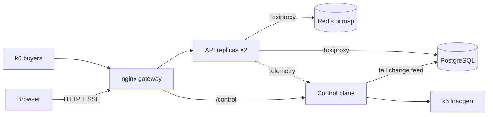

# FlashSeat

**A ticket on-sale you can watch, and break.** Thousands of real HTTP buyers queue, grab the best seats they can, lose races, pay, or walk away, while a Go reservation engine keeps every seat sold exactly once. A live seat map, drawn straight from PostgreSQL's change feed, shows every seat as it is held, sold, or released.

Inject a real fault mid-sale (cut Redis, wipe Redis, slow PostgreSQL, kill an API replica) and watch the correctness checks stay at zero. Then run the same crowd against a naive engine and watch seats get sold twice.

## Measured results

Same machine, same crowd: a 9,000-seat arena, 6,000 k6 buyers arriving over 15 seconds, no waiting room, 10-second holds. Apple M4, 16 GB, everything (k6 included) in Docker Desktop.

| | FlashSeat engine | Naive baseline |
|---|---:|---:|
| Seats sold (distinct, from PostgreSQL) | 8,581 (95.3%) | 4,182 |
| Tickets buyers were charged for (k6) | 8,581 | 10,659 |
| **Seats sold to more than one buyer** | **0** | **2,131** |
| Seats resold after a hold expired | 1,456 | 1,256 |
| Orders committed but never confirmed to a buyer | 0 | 0 |

With all four faults injected during one FlashSeat sale (API replica killed, Redis cut for 6 s, PostgreSQL slowed by 80 ms, Redis wiped), there were still 0 double-sales and 0 Redis/PostgreSQL drift after recovery. During the Redis cut, 3,843 hold requests failed closed with `503` instead of writing without protection. After the wipe, holds returned `503 inventory_rebuilding` until the bitmap was restored from PostgreSQL.

Details, including where latency goes and what is not yet fixed, are in [docs/BENCHMARKS.md](docs/BENCHMARKS.md).


## Run it

Prerequisite: Docker Desktop with Compose. k6 runs inside the stack.

```bash
docker compose up --build
```

Open http://localhost:3000, choose a venue and engine, and open the sale. Recorded runs are at `/runs`, and `/compare` replays two runs side by side on one clock.

`make reset` wipes the database, including recorded runs.

To put it on the internet with HTTPS on your own domain, see [docs/DEPLOY.md](docs/DEPLOY.md). It covers one server and one command.

## What happens during a sale

1. The control plane rebuilds the venue (1,170 or 9,000 seats), loads a fresh Redis seat bitmap, and opens the waiting room.
2. k6 sends buyers at a steady arrival rate. Each buyer gets a session, takes a queue ticket, and long-polls until admitted.
3. Admitted buyers ask for 1–4 seats together. About half want any tier; the rest want a specific price tier and settle for any tier if theirs sells out. The server picks the best contiguous block, and retries on its own if another buyer claims it first.
4. Buyers think for 1–4 seconds, then 72% check out, 10% release their seats, and 18% walk away and let the hold expire. Expired seats go back on sale and are often resold.
5. API replicas stream outcome counts and latency histograms to the control plane every 250 ms. The control plane tails PostgreSQL's change feed for seat changes and re-checks the invariants every second.
6. When the sale settles, the run is saved with server metrics, the k6 client summary, the final invariant check, and a compressed seat-by-seat replay.

## Architecture



The hold path costs one Redis read, one atomic Lua claim, and one PostgreSQL function call:

- **Redis bitmap + Lua.** One bit per seat. `claim.lua` claims a whole block all at once or not at all, tracks the claim's expiry, and frees abandoned seats by itself. Release is scoped to the claim's token.
- **Best-available picker.** It ranks rows by tier, depth, and centrality, then picks among the top blocks with a bias toward the best, so concurrent buyers spread out instead of colliding on one block (≈0.7 µs on a half-full 9,000-seat arena).
- **One round trip to PostgreSQL.** `fs_create_hold` handles idempotency replay, locks seat rows in index order (no deadlocks between overlapping multi-seat requests), expires lapsed holds inline, enforces one active hold per buyer, and inserts. Unique indexes are the last line of defense.
- **Waiting room.** Admission is a pure function of time (`ticket ≤ (now − opened) × rate`), so replicas agree without coordinating. Tickets come from a PostgreSQL sequence and passes are HMAC-signed.
- **Exact recovery.** If Redis loses its data, holds fail closed until the bitmap is rebuilt from PostgreSQL. The rebuild waits for in-flight transactions to finish, so the snapshot is exact.

The full design, including why Redis always expires after PostgreSQL and how the change-feed cursor handles out-of-order commits, is in [docs/ARCHITECTURE.md](docs/ARCHITECTURE.md). The API contract is in [docs/openapi.yaml](docs/openapi.yaml).

## Tests

```bash
make test-go            # unit tests: picker, waiting room, board, feed cursor, telemetry
make test-integration   # PostgreSQL + Redis: one winner per seat, no deadlocks, lazy expiry, idempotent checkout
make test-web           # typecheck, lint, production build, rendered routes
```

Correctness during a sale is judged from PostgreSQL. In safe mode, "seats sold twice" cannot rise above 0 because unique indexes forbid it, so the run also counts **backstop hits**: writes one of those indexes rejected after the engine's own locks and checks let them through. A safe run fails if there are any. The measured results above predate this check.

Databases created before `008_backstop_hits.sql` need `make reset` (migrations only run on a fresh volume).

CI runs all three on every push, plus a build of every service image.

## Repository map

```text
app/, components/, lib/   Next.js UI: live sale, run history, replay, compare
apps/api/cmd/api          Data plane: sessions, waiting room, holds, checkout
apps/api/cmd/control      Control plane: runner, change-feed hub, invariants, faults, expiry sweeper
apps/api/internal/venue   Layouts and the best-available picker
apps/api/internal/inventory  Redis bitmap and Lua scripts
apps/loadgen              Allowlisted k6 runner and the buyer-journey scenario
infra/migrations          Schema and the PL/pgSQL reservation functions
infra/gateway             nginx load balancer
infra/toxiproxy           Fault-injection proxies
```

## Limits

This is a systems project, not a ticketing business. Payments are simulated, identity is a cookie, and there is no bot defense. Every service, k6 included, shares one machine in the default setup, so the absolute numbers describe a laptop. The interesting results are the relative ones: same load, same hardware, different concurrency control.
