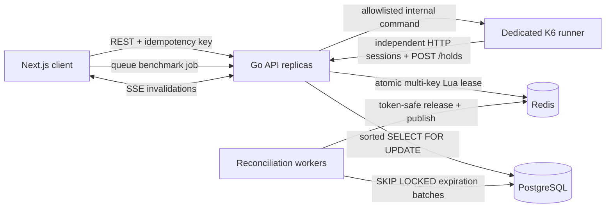

# FlashSeat architecture

PostgreSQL is the authority; Redis is an admission-control accelerator. A Redis lease never means a seat is sold. Only a committed PostgreSQL order does.



## External benchmark evidence path

The UI never fabricates buyers or latency. `POST /benchmarks` inserts a durable queued job and returns `202`. The API calls a separate, non-root K6 service that can run only the bundled same-seat scenario against the allowlisted internal API URL. Each K6 VU creates its own demo-session cookie, waits at a shared timestamp barrier, and calls the same public hold handler used by normal clients.

K6 returns hold-specific P50/P95/P99, response counters, and the number of VUs that missed the shared release barrier. Before cleanup, the API independently counts active claims in PostgreSQL. A job passes only when every VU reaches the barrier, attempts equal the requested VUs, one request returns `201`, every other request returns expected `409`, unexpected errors equal zero, and the database contains exactly one live claim. The job and raw summary are committed before the winning test hold is token-safely released.

The live visualization is sourced separately from the final K6 summary. Middleware around the real `/holds` handler recognizes benchmark idempotency keys and increments job-scoped atomic counters only after the handler chooses its HTTP status. The browser polls those counters and compresses observed deltas into readable packets. Thus packet count is a visual aggregation, while displayed attempts, winners, conflicts, errors, and progress are exact. Restarting the API fails any interrupted benchmark, so in-memory live telemetry cannot be mistaken for a completed durable result.

## Hold sequence

```mermaid
sequenceDiagram
  participant C as Client
  participant A as API
  participant R as Redis
  participant P as PostgreSQL
  C->>A: POST /holds + Idempotency-Key
  A->>R: acquire.lua(all seat keys)
  R-->>A: all acquired or conflict
  A->>P: BEGIN; lock sorted seat rows
  A->>P: verify + insert hold/items + audit
  P-->>A: COMMIT
  A->>R: publish inventory invalidation
  A-->>C: 201 Hold
```

The partial unique index on unreleased `hold_items.seat_id` and unique `order_items.seat_id` are final invariant guards. Sorted row locking prevents lock-order inversions for multi-seat requests. Acquisition is all-or-none.

## Expiration and failure behavior

- Every request compares the PostgreSQL `expires_at` value to server time. TTL is not authoritative.
- Redis keyspace notifications are enabled for operational visibility, but correctness does not depend on delivery.
- Any number of workers can claim expired rows with `FOR UPDATE SKIP LOCKED`; only one transitions each hold.
- Lease release checks the ownership token, preventing a stale request from deleting a newer lease.
- If Redis is unavailable, the MVP fails hold creation closed. Reads and existing PostgreSQL state remain correct.
- This deployment has one Redis node, so it does **not** claim Redlock. A real Redlock deployment needs independent Redis masters and still would not replace database invariants.

## Production gaps

Real identity, PCI-compliant payments, a waiting room, abuse controls, multi-region write ownership, durable event streaming, schema migration orchestration, and autoscaling policies are intentionally outside this portfolio MVP.
