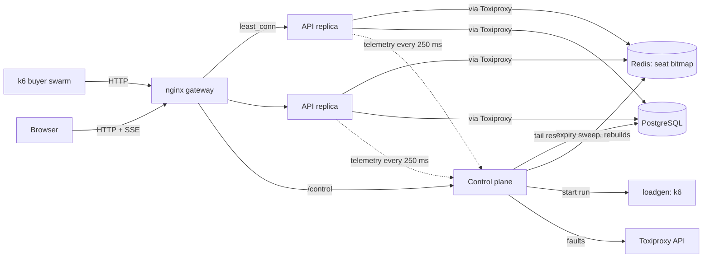
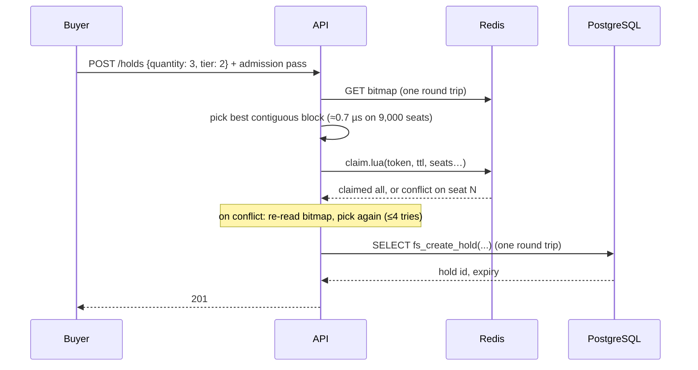

# FlashSeat architecture

PostgreSQL decides who owns a seat. Redis decides, cheaply, which requests are certain to lose so PostgreSQL never sees them. The control plane watches, measures, and breaks things, but the data plane never depends on it.

## Hold path

### Redis: one bitmap per event

Each seat has a bit index. `claim.lua` runs atomically inside Redis:

1. Refuse if the inventory is not loaded (`ready` key missing). The API returns `503` and starts a rebuild.
2. Free seats whose claims have expired (up to 64 per call), using a sorted set of claim expiries.
3. If any requested bit is set, return the conflicting seat. Nothing is written.
4. Otherwise set every bit, record the claim's seats under its token, and schedule its expiry.

Release and confirm are token-scoped, so a slow request can never free seats that now belong to someone else. Confirmed (sold) seats keep their bits forever.

The Redis expiry is the PostgreSQL TTL plus 2.5 s. PostgreSQL computes `expires_at` at transaction start, which is at most `HoldTxTimeout` (2 s) after the Redis claim, so Redis always frees a seat after PostgreSQL does. It never frees one early.

### Best-available selection

`venue.Pick` ranks rows by tier, distance from the stage, and distance from the center line. It collects the best few contiguous blocks and chooses among them with a bias toward the best. Choosing only the single best block would send every concurrent buyer to the same seats; spreading across near-equivalent blocks cuts lost races without visibly worse seats.

### PostgreSQL: one function call per write

`fs_create_hold`, `fs_checkout`, and `fs_release` (in `infra/migrations/007_onsale_engine.sql`) do all of their work in one round trip:

- Idempotency replay by `(user_id, idempotency_key)`, including when a concurrent duplicate committed while this call waited on a lock.
- `SELECT … ORDER BY seat_index FOR UPDATE`. Every writer locks seats in the same order, so overlapping multi-seat requests cannot deadlock. The integration suite fires 200 overlapping 4-seat requests, in shuffled input order, to check this.
- Lazy expiry. Lapsed holds blocking the requested seats are expired inside the same transaction, so a seat can be resold the instant its hold lapses rather than at the next sweep.
- The one-active-hold-per-buyer rule, enforced by a partial unique index.
- The final guards: a partial unique index on unreleased `hold_items.seat_id`, and `UNIQUE(order_items.seat_id)`. Even if the application regressed, PostgreSQL would reject a double sale.
- Because those guards make "seats sold twice" 0 by construction, that count alone cannot show the engine works. Every time one of them rejects a write, the store logs a row in `backstop_hits` before returning the usual `409`, and a safe run fails its invariants if any row exists. Zero hits means the row locks and the functions' own checks stopped every collision before the indexes had to.

Custom SQLSTATEs (`FS409`, `FS410`, …) map straight to HTTP statuses.

### When PostgreSQL's answer is unknown

If the hold transaction times out, the API cannot know whether it committed. It does not release the Redis claim in that case, and lets the claim expire instead. A seat that is briefly unavailable is safe; a seat that looks free while it is actually held is not.

## Waiting room

Tickets come from a PostgreSQL sequence, so the queue survives a Redis wipe. Admission is a pure function of time: ticket `n` is admitted at `opened_at + n / rate`. Every replica agrees without coordinating. The status endpoint long-polls by sleeping until the ticket's known admission time, instead of the client polling. Tickets and admission passes are HMAC-signed and bound to buyer, event, and inventory version, so they are checked without a lookup and cannot be reused across runs.

## Control plane

`cmd/control` runs:

- **Change-feed tailer.** It reads `reservation_events` in id order. Sequence values are assigned at insert but become visible at commit, so a lower id can appear after a higher one. The cursor stops at a gap, waits up to 1 s for it to fill, and then treats it as a rolled-back insert. Because every seat change comes from committed PostgreSQL rows, the live map and the replays show the database itself, not what the API intended.
- **Board.** It counts live claims and sales per seat rather than trusting a status, so a seat claimed or sold twice shows up red whichever code path wrote it.
- **Invariant checker.** Every second it queries PostgreSQL for seats sold twice, overlapping live claims, stale holds, and order totals that don't match their line items. In safe mode it also compares Redis with PostgreSQL, and re-asserts sold seats, the one direction that is always safe to repair.
- **Expiry sweeper.** `fs_expire_due` claims past-due holds with `FOR UPDATE SKIP LOCKED`, so any number of sweepers can run.
- **Runner.** It resets the venue (bumping the inventory version so no Redis state survives), loads the bitmap, opens the waiting room, drives k6, waits for holds to settle, runs the final check, and stores metrics plus a gzip-compressed seat-by-seat timeline.
- **Fault injection.** API replicas reach Redis and PostgreSQL through Toxiproxy, so "Cut Redis" is a real dropped connection and "Slow Postgres" is real added latency. "Wipe Redis" runs `FLUSHALL`. "Kill an API replica" makes one process exit mid-traffic; nginx routes around it while Docker restarts it.

## Rebuilding a lost inventory

When the bitmap is missing, claims are refused, so no new PostgreSQL holds can start. The first replica to notice takes a rebuild lock and waits `HoldTxTimeout + 0.5 s`. By then every transaction that won a claim before the loss has committed or aborted. It then snapshots sold seats and live holds from PostgreSQL and loads them in one `MULTI/EXEC`. The snapshot is exact, not approximately right.

## The naive baseline

Naive mode is the comparison engine. It reads availability, picks seats in Go, and inserts into `naive_claims`, with no transaction, no lock, and no unique constraint. Every statement is individually correct; the bug is the gap between the read and the write. Both engines share the picker, the API, the waiting room, and the load, so the only difference between runs is the concurrency control.

## Failure semantics

| Situation | Behavior |
|---|---|
| Two buyers want the same seats | One wins in Redis. The loser's server re-picks up to 4 times, then returns `409 seat_unavailable` |
| No block of the requested size left | `409 sold_out`. The k6 buyers relax their tier, then their group size |
| Redis unreachable | `503 redis_unavailable`. No PostgreSQL write is attempted |
| Redis data lost | `503 inventory_rebuilding` until the exact rebuild finishes |
| Hold transaction times out | `503 timeout`. The claim expires on its own; the client retries with the same key |
| Hold lapses | Freed lazily by the next buyer who wants it, or by the sweeper within 500 ms |
| Duplicate request | The original hold or order is returned |
| API replica dies | In-flight requests fail and the gateway retries only connection errors. Clients retry with their idempotency key |

## Known limits

- One Redis node and one PostgreSQL primary. The design does not claim Redlock or multi-region writes.
- All services, including the load generator, share one machine in the default setup, so the absolute numbers measure a laptop.
- Payments, authentication, and bot defense are simulated or out of scope.
